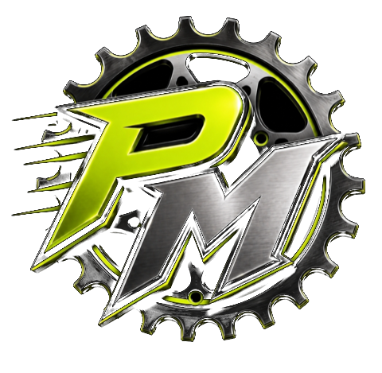

<div align="center">
  
  <h1>Punto Moto</h1>
  <p>Gestión local para tiendas de repuestos y talleres de motocicletas.</p>
  <p><strong>Windows · React + TypeScript · Tauri 2 · Django · SQLite</strong></p>
  <p>
    <a href="https://github.com/Jcabr3ra1/Punto_Motos/releases/latest">Descargar para Windows</a> ·
    <a href="docs/PUBLICACION.md">Publicar una versión</a> ·
    <a href="docs/backend/API.md">Contrato de la API</a>
  </p>
</div>

Punto Moto funciona en un solo computador con Windows y guarda los datos en su disco local. La versión instalada incluye el frontend, Django y su entorno de ejecución: el usuario final no necesita instalar Python, Node ni Rust.

> **Versión inicial para pruebas.** Revisa el estado de los módulos antes de usarlo como sistema del negocio. Las copias externas y la impresión todavía están pendientes.

## Descargar e instalar

1. Abre [la última versión publicada](https://github.com/Jcabr3ra1/Punto_Motos/releases/latest).
2. Descarga el archivo `Punto.Moto_<versión>_x64-setup.exe` y ejecútalo en Windows de 64 bits.
3. Abre Punto Moto desde el menú Inicio. En el primer uso crea la cuenta del dueño.

El instalador es por usuario. Usa WebView2 de Windows; si falta, su bootstrapper necesita internet para instalarlo. Las actualizaciones tienen firma criptográfica propia de Tauri. Esto es distinto de un certificado comercial de editor de Windows: Windows puede mostrar un aviso de editor desconocido.

## Actualizaciones desde el programa

El dueño puede revisar las versiones desde **Inicio → Actualizaciones del programa**. Cuando hay una nueva, el programa ofrece **Actualizar y reiniciar**. Guarda tus operaciones y confirma cuando puedas cerrar la aplicación. La nueva versión incluye juntos interfaz, backend y escritorio.

La descarga se verifica antes de ejecutar el instalador. Sin internet, puedes seguir trabajando con la versión instalada. Los datos están fuera de la carpeta del programa; antes de aplicar migraciones pendientes sobre una base existente se crea un respaldo local verificado. No se hacen retrocesos automáticos de esquema.

## Funciones disponibles

| Área | Implementado |
| --- | --- |
| Acceso | Primer dueño, usuarios, roles y sesiones |
| Catálogo | Productos, códigos internos, tipos, marcas y motos |
| Inventario | Existencias, movimientos, ajustes y conteo inicial |
| Compras | Proveedores, borradores, recepción, costos y abonos |
| Ventas | Clientes, carrito, pagos y anulación completa |
| Caja | Apertura, gastos, retiros, cierre e historial |
| Taller | Servicios, mecánicos, porcentajes y liquidación diaria |
| Consignaciones | Entregas, reportes y pagos de otros locales |
| Escritorio | Django integrado, datos locales e instancia única |

**Pendiente:** devoluciones parciales y de servicios, cierres y reportes mensuales, impresión ESC/POS y respaldos externos. El respaldo previo a migraciones no sustituye la política completa de recuperación del negocio.

## Desarrollo

Si retomas el proyecto como colaborador o con otra IA, empieza por [AGENTS.md](AGENTS.md). Explica cómo entregar cambios a instalaciones existentes, conservar las claves de firma y publicar nuevas versiones. Subir código por sí solo no activa una actualización.

Consulta [la guía de escritorio](desktop/README.md) para instalar los requisitos. Desde la raíz:

```powershell
npm.cmd ci --prefix frontend
npm.cmd ci --prefix desktop
python -m venv backend/.venv
backend/.venv/Scripts/python.exe -m pip install -r backend/requirements-build.txt
cd desktop
npm.cmd run doctor
npm.cmd run dev
```

Para construir el instalador firmado: `npm.cmd run build` dentro de `desktop/`, con la clave de firma configurada. Para publicar futuras versiones, sigue [la guía de publicación](docs/PUBLICACION.md).

## Organización

| Carpeta | Contenido |
| --- | --- |
| [frontend/](frontend/README.md) | Interfaz React y TypeScript |
| [desktop/](desktop/README.md) | Ventana Tauri, actualizador y empaquetado Windows |
| [backend/](backend/README.md) | Django, API y reglas del negocio |
| [docs/](docs/) | Informe, contratos y guías |

**Juan:** frontend y escritorio. **Alex:** backend y reglas del negocio. Cada cambio del backend mantiene actualizado el [contrato](docs/backend/API.md) y la [bitácora](docs/backend/CAMBIOS.md), según [CLAUDE.md](CLAUDE.md).

## Documentación

- [Informe funcional y técnico](docs/informe_proyecto_taller.md) · [versión Word](docs/informe_proyecto_taller.docx).
- [Preparación y ejecución del escritorio](desktop/README.md).
- [Publicación, claves y actualizaciones](docs/PUBLICACION.md).
- [Notas de la versión](docs/RELEASE_NOTES.md).
- [API del backend](docs/backend/API.md) · [cambios para el frontend](docs/backend/CAMBIOS.md).
